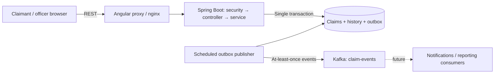
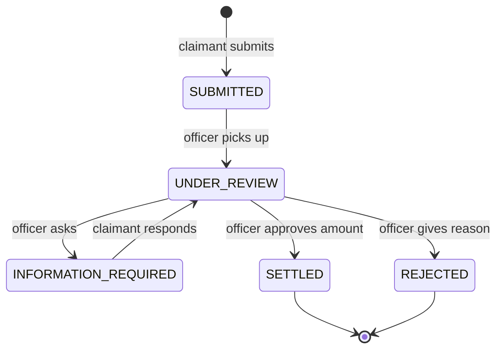

# Architecture and decisions

## Scope

One deployable Spring Boot service owns claims, assessment, history, dashboard queries, and the event outbox. The application targets the assessment's core journey; it is not a finished insurance product. The UI is a small role-aware Angular application.

Notifications/reporting consumers are explicitly future work. A real producer and durable outbox are implemented; no downstream Kafka consumer is included.

## Domain and lifecycle

A claim has a claimant, type (motor/property), demo market, market currency, incident date, description, estimated loss, assigned officer, status, timestamps, optional settlement amount, and a version. Its append-only history records actor, time, resulting status, and message. Outbox events reference the claim and its version.

Only the assigned officer can request information or decide. Final states cannot reopen. Assignment is self-pickup; reassignment and manager roles are deferred. Claims cannot be decided while waiting for information.

## REST versus Kafka

Submission, queries, assignment, information exchange, and decisions use REST because a user needs immediate validation and a clear response. Changes append an outbox row in the same transaction as the claim. A scheduled publisher sends pending rows to `claim-events` and marks them published after broker acknowledgement.

Kafka is suitable for future notifications and integrations that should not block the claim transaction. A failed broker leaves the row pending for retry. Publishing is disabled for an H2-only local run and enabled in Compose.

Delivery is **at least once**: if the process crashes after Kafka acknowledges but before the database records publication, the next run repeats the event. Consumers must deduplicate `eventId`; `claimVersion` helps reject stale events. Claim UUID is the Kafka key. This demo runs one publisher instance; multi-instance deployments require outbox row leasing/locking, ordering guarantees, and metrics. The outbox is not an exactly-once implementation.

## Correctness and security

- Server validates dates, amounts, enums, market, message lengths, and allowed transitions.
- `BigDecimal` and decimal database columns preserve monetary precision. UI numbers are only input/display values.
- Mutations require the last observed claim `version`. JPA `@Version` also catches competing commits. Stale edits return 409 and require a refresh.
- Spring Security enforces officer endpoint access. Claimants see only their own claims; another claimant's UUID returns 404.
- Demo HTTP Basic accounts are in memory, with BCrypt password hashes. API is stateless, uses explicit Authorization headers, and has no cookie-based session. CSRF is disabled for that API model. Browser-native Basic-auth reuse and a production deployment would require a fresh CSRF/authentication review.
- Local HTTP demo only. Production requires TLS, OIDC, real user provisioning, secrets management, and identity-derived ownership.
- API response DTOs keep persistence internals separate. Kafka payloads omit free-text descriptions, claimant information, and assessment messages.

## Dashboard semantics

Open statuses are SUBMITTED, UNDER_REVIEW, INFORMATION_REQUIRED. Outstanding exposure is the sum of their submitted estimated loss, grouped by currency. Closed settlements sum approved settlement amounts by currency. Counts show all statuses, and open workload groups by assigned officer plus Unassigned. These basic metrics show workload and outcomes; there is no SLA or handling-time analysis yet.

The six market codes MY/SG/HK/TH/ID/VN and their currencies are demo assumptions because the brief does not name the markets. There is no FX conversion, policy validation, deductible, reserve model, coverage check, or payment execution. SETTLED means the officer recorded a settlement decision, not that money was transferred.

## Deliberate shortcuts and next priorities

1. No policy or attachment model. Add policy/coverage validation and secure document storage before real claims processing.
2. In-memory demo identity. Replace with OIDC and multi-user tests using real identities.
3. JPA schema `update` for local speed. Introduce Flyway migrations and PostgreSQL integration tests before production.
4. Lists and dashboard aggregate in memory. Add pagination, filters, database aggregation, and indexes as volume grows.
5. No submit idempotency key. A client retry after a lost response can duplicate a claim. Add a persisted idempotency key per claimant.
6. Single outbox publisher; no consumer, metrics, or dead-letter policy. Add deduplication-aware notifications, backlog monitoring, row leasing, and retention.
7. Single Angular component and simple polling. Add browser tests, extract components, and consider SSE if near-instant updates matter.
8. History messages are visible to both roles. Separate internal notes from claimant-visible correspondence in a richer model.

## Technology rationale

Java 21 and Spring Boot 3.5 keep the implementation in the user's familiar ecosystem. Angular 20 meets the required frontend framework without extra UI libraries. H2 gives a quick standalone run; PostgreSQL is the Docker database. Maven and npm lockfiles/builds make checks repeatable. Docker Compose describes the full local topology.

Official references used when selecting tooling: [Spring Boot 3.5 requirements](https://docs.spring.io/spring-boot/3.5/system-requirements.html) and [Angular version compatibility](https://angular.dev/reference/versions).
